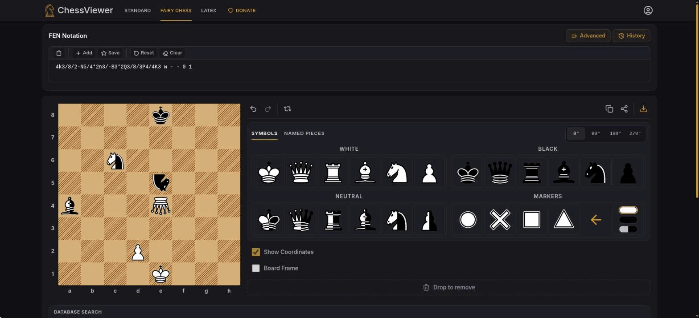
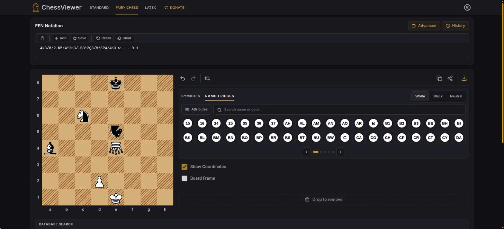
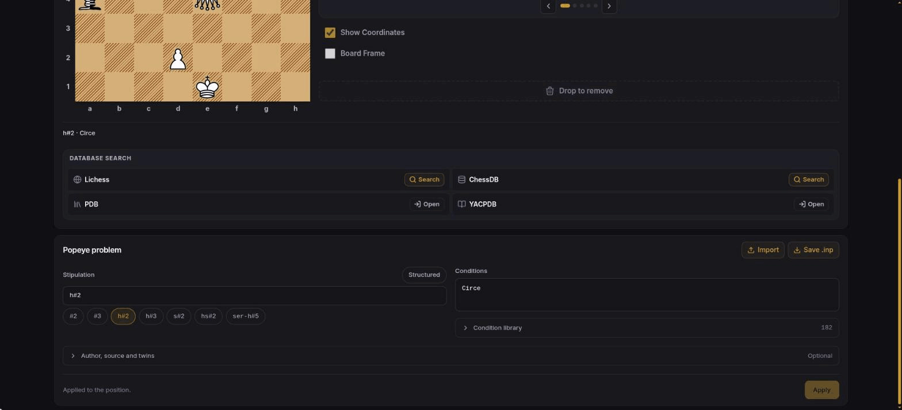

# Fairy chess diagrams and Fairy FEN

ChessViewer is a position and diagram editor. The standard editor and fairy editor
both allow free placement; neither is a move-legality engine or a problem solver.

## Sources and meaning

The implementation follows Joost de Heer's [Fairy FEN specification](https://www.janko.at/Retros/d.htm).
This is a composition diagram notation, not a universal engine format for every
chess variant. Fairy-Stockfish's extended FEN is a different convention; its
arbitrary piece letters do not describe the neutral/rotated diagram symbols used
here.

A rotated glyph is a diagram symbol. Its rotation does not, by itself, specify a
move rule. The [Unicode fairy-symbol proposal](https://www.unicode.org/L2/L2017/17034r3-n4784r-fairy-chess.pdf)
explains that most symbol assignments depend on the composition. In particular,
an upside-down queen conventionally represents a Grasshopper, and an upside-down
knight a Nightrider. Custom meanings belong in the problem's stipulation or legend.
We consequently name arbitrary rotated pieces by their symbol and angle, rather
than inventing a piece name or move rule for every rotation.

The [WFCC's published definitions](https://www.wfcc.ch/wp-content/uploads/WCCC-2021-bulletin-v1.1.pdf)
distinguish:

- Grasshopper: hops along a queen line over a hurdle and lands immediately beyond.
- Nightrider: repeats knight steps along one straight direction.
- Neutral unit: either side can move or capture it. Neutral is a property of a
  piece, not a third player or a white piece painted in two colours.

The [BCPS beginner guide](https://www.theproblemist.org/beginner.pl?type=b_fy) and
[Julia's Fairies glossary](https://juliasfairies.com/fairy-terms/jf-fairy-terms/)
provide the piece and condition definitions. The image generator combines the
white and black artwork for neutral symbols, and rotates the whole neutral glyph.

## Workspaces and composition settings

`/` is the orthodox editor, `/fairy-chess` the fairy diagram workspace and
`/latex` the independent LaTeX Studio. The fairy workspace reuses the standard
editor (FEN field, board, command bar, board options) and adds two things.



**The piece panel** beside the board has two tabs:

- **Symbols** — the six orthodox shapes in white, black and neutral, a rotation
  switch (0°, 90°, 180°, 270°) and diagram markers. Drag a symbol onto the board or
  select it and click a square.
- **Named pieces** — the Popeye catalogue as letter discs, paged in two rows with
  dots, arrows and swipe. A White / Black / Neutral switch sets the colour; the
  search field matches names and codes; **Attributes** toggles Popeye attributes
  such as Royal or Chameleon, and named pieces placed while one is on carry it.



**The Popeye problem card** below the editor holds the composition: stipulation
(free text, quick presets such as `#2`, `h#2`, `s#2`, or a structured Popeye expression),
conditions (one per line, with a searchable library of 182 names), and the
optional author, source, title, remarks and twins. **Apply to position** writes them to the
position; the legend under the board then shows the stipulation and conditions.
**Import** reads a Popeye file and **Save .inp** downloads one after pending changes
have been applied. The condition library opens across the full panel width;
**Problem details** groups publication fields separately from remarks and twins.



The catalogue contains 163 walks from the official English
[Popeye manual](https://github.com/thomas-maeder/popeye/blob/develop/py-engl.txt)
and [piece-name table](https://github.com/thomas-maeder/popeye/blob/develop/piecenam.txt),
including the six orthodox walks. The condition picker contains 182 names and the
attribute picker contains 19 attributes. Choosing a condition stores it in the
problem; opening computer analysis asks Popeye to solve it under that condition.
An unsupported or malformed declaration produces an engine error rather than a
fabricated solution.

## Computer analysis

The computer icon opens Popeye 4.103 in the side panel. Its stipulation display
shows the problem's goal, while the solution rows show actual variations. The
settings control time, memory, maximum solutions, threats and defensive
variations. Hover over a move for a position preview; select it to inspect the
position on the main board. Search limits can leave more solutions undiscovered.

Popeye is distinct from Stockfish on the Standard page: it reads Popeye problem
notation and fairy movement rules, and it does not produce a centipawn score.
See [computer analysis](ENGINES.md) for worker delivery and license/source links.

Named pieces preserve their identity independently of artwork. Conventional
Popeye diagram glyphs are used where available. Walks without an assigned glyph
use their letter code, with color and a printed legend. Two walks sharing a glyph
remain different pieces in storage, history, undo and export.

## Supported notation

The current board is 8 × 8. The symbol palette supports the six orthodox glyph
families in white, black and neutral, with 0°, 90°, 180° and 270° clockwise
rotations (72 symbols). Named walks are available separately in the catalogue.
FFEN's markers, text labels, intermediate knight angles and other board sizes are
outside this feature; unsupported syntax is rejected with a validation error.

| Meaning                     | FFEN             | Internal image key |
| --------------------------- | ---------------- | ------------------ |
| White bishop                | `B`              | `wB`               |
| Black bishop                | `b`              | `bB`               |
| Neutral bishop              | `-B` or `-b`     | `nB`               |
| White bishop, 90° clockwise | `*1B`            | `wB90`             |
| Black queen, 270° clockwise | `*3q`            | `bQ270`            |
| Neutral rook, 180°          | `-*2r` or `-*2R` | `nR180`            |

Neutral letter case is insignificant; output uses uppercase neutral glyphs.
Ordinary FEN letters retain their original meaning. In FFEN, `N` is the ordinary
knight glyph; the problemist abbreviation N for Nightrider is not substituted
into the FEN placement. Its conventional inverted-knight symbol is `*2N`.

Placement-only input is accepted for diagrams. Full positions retain the usual
five metadata fields, which are validated. Canonical editor output includes all
six fields. FFEN records symbol placement; it does not encode fairy conditions,
royalty, a solver's piece declarations or the complete rules of a variant.

Standard FEN keeps the dependency's existing length guard. FFEN input has a
separate bounded limit allowing three prefix characters per square. Shared
validation and parsing cover the editor, previews, history, favourites, batch,
sharing and raster/SVG exports. Plain FEN is never produced by discarding fairy
information.

## Popeye files

Named walks, attributes and problem declarations use English Popeye notation,
not invented FEN letters. In Popeye `S` is the ordinary knight and `N` is the
Nightrider. In orthodox FEN and FFEN `N` retains its ordinary-knight meaning.

```text
BeginProblem
Stipulation h#2
Condition Circe
Pieces White Ke1 Ge4
Pieces Black Ke8 Ne5
Pieces Neutral PAa4
EndProblem
```

`Pieces` color groups, `Forsyth` placement, stipulations, conditions, options,
authorship, remarks and raw twin declarations are preserved. Forsyth supports
optional rank separators, color overrides and two-character walk codes. One
8×8 problem is imported at a time; overlapping/underworld units are rejected.
Twin declarations are retained as text, rather than automatically generating
transformed twin boards. Other board dimensions, arbitrary hunter definitions
and unrecognized commands are rejected instead of being silently discarded.

The file importer accepts `.inp`, `.txt` and `.fen`; Save Popeye downloads an
`.inp` file. Compositions have a 32768-character bound. Popeye shares use a URL
fragment to avoid sending the whole document in the HTTP request path.

Two valid `Remark` comments preserve editor-only information when needed:
`ChessViewerFEN` retains the ordinary five FEN metadata fields, and
`ChessViewerSymbols` retains unnamed rotated glyphs mixed with named walks.
These comments are ChessViewer conventions, not a universal extension to FEN;
Popeye reads them as remarks. Arbitrary symbol rotations do not assert a walk.

PNG/JPEG/SVG exports include a composition legend, conditions and metadata.
SVG also embeds the source notation. LaTeX uses documented `\pieces` and
`\fieldtext` commands; unassigned glyphs use explicit color-prefixed walk codes.

## Integration

- Standard assets: `/piece/<set>/<piece>.svg`.
- Generated fairy assets: `/fairypiece/<set>/<piece>.svg`.
- `pnpm pieces:fairy` regenerates the fairy directory from the twelve originals.
- Orthodox database searches are disabled for fairy positions; FFEN is never sent
  to a service expecting ordinary FEN.
- LaTeX Studio uses `diagram` for fairy positions. Its documented `\pieces` syntax
  supports neutral units and R/U/L rotations. The other package choices are
  unavailable while the project contains fairy symbols. Counts include neutral
  pieces separately.

Regression tests: `tests/fairyFen.test.ts`, `tests/boardCells.test.ts`,
`tests/fairyPieces.test.ts`, `tests/popeye.test.ts` and the SVG export tests.
