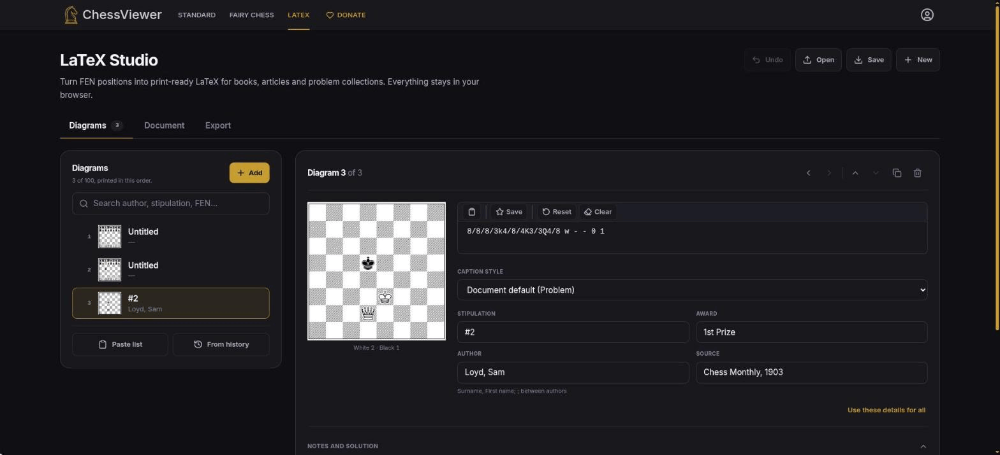
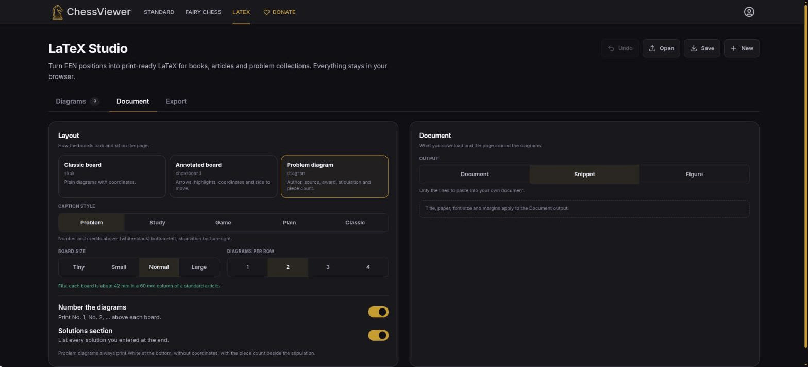
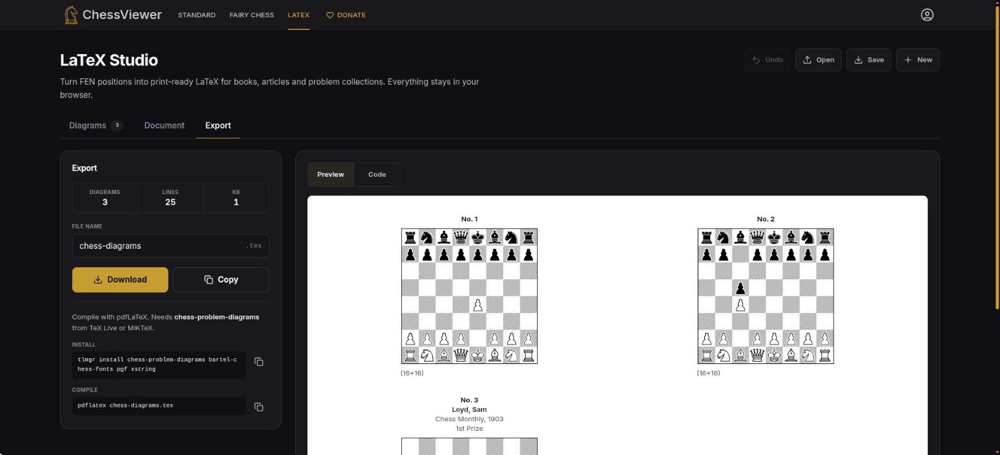

# LaTeX Studio

Technical reference for the **LaTeX Studio** page at `/latex` ([issue #165](https://github.com/chessviewer-org/chess-viewer/issues/165)).

---

## Table of Contents

- [Overview](#overview)
- [Supported Packages](#supported-packages)
- [Installing TeX](#installing-tex)
- [Output Modes](#output-modes)
- [Document Settings](#document-settings)
- [Option Mapping](#option-mapping)
- [Validation and Safety](#validation-and-safety)
- [API](#api)
- [Entry Points](#entry-points)
- [File Reference](#file-reference)

---

## Overview

LaTeX Studio is a standalone page that turns one or many positions into LaTeX for books, bulletins and problem collections. Nothing is rendered or compiled in the browser — the output is plain text that you copy or download as a `.tex` file.

- Three packages: `skak`, `chessboard` and `diagram` (`chess-problem-diagrams`)
- Up to 100 positions, added with the regular FEN input (paste, favourites, start/clear), reordered, duplicated, filtered or pasted in bulk (`FEN | author | source | stipulation`)
- Per-position problem details: stipulation, author, source, award, remark, solution and caption
- Caption styles for the text around each board — Problem (number and credits above, `(white+black)` bottom-left, stipulation bottom-right), Study, Game (players, event and date above, side to move below), Plain and Classic — set for the document and overridable per diagram; game diagrams take White, Black, Event and Date
- `chessboard` highlights, circles and arrows
- Snippet, full document or cropped standalone figure
- Document class, paper, font size, margin, title page, columns, numbering, piece count and a Solutions section
- Four diagram sizes: `tiny`, `small`, `normal`, `large`
- Diagrams open in place in the list for editing, with "Use these details for all"
- A layout check that warns when boards are wider than their column and offers the column count that fits
- Live preview on a white paper sheet and syntax-coloured code, copy, `.tex` download and the exact `tlmgr` and `pdflatex` commands
- The project is kept in `localStorage` (`cv_latex_project`), can be saved to and opened from a `.json` file, and Undo reverses delete, new project and open
- Layout: three tabs — Diagrams, Document and Export — with Undo, Open, Save and New in the page header
- The install command lists every TeX Live package a fresh TinyTeX needs for the chosen style and output, and the layout check also covers snippets against a standard article text width

### Screens

The page has three tabs.

- **Diagrams** — the list of positions on the left (add, search, paste a list, add from history) and the editor for the selected diagram on the right: FEN, caption style, stipulation, award, author, source, notes and solution.

  

- **Document** — the layout (Classic board `skak`, Annotated board `chessboard`, Problem diagram `diagram`), caption style, board size, diagrams per row, numbering and the solutions section; on the right the output type (Document, Snippet, Figure) with paper, font and margins.

  

- **Export** — the file name, Download and Copy, the exact install and compile commands, and a Preview / Code switch.

  

---

## Supported Packages

### skak

```latex
\usepackage{skak}
\fenboard{rnbqkbnr/pppppppp/8/8/8/8/PPPPPPPP/RNBQKBNR w KQkq - 0 1}
\showboard
```

`\showinverseboard` replaces `\showboard` for a flipped board, and `\notationoff` precedes the diagram when coordinates are hidden, followed by `\notationon` afterwards — skak's switch is global, so this keeps later diagrams in the same document unaffected.

### chessboard

```latex
\usepackage{chessboard}
\chessboard[setfen=rnbqkbnr/pppppppp/8/8/8/8/PPPPPPPP/RNBQKBNR w KQkq - 0 1]
```

Highlighted squares, circles and arrows become `markfields` and `markmoves` keys grouped by style and colour, with an `\definecolor` line per colour:

```latex
\chessboard[
  setfen=…,
  pgfstyle=color,
  color=cvFFEB3B!55,
  markfields={e4,d5},
  pgfstyle=straightmove,
  color=cv15781B,
  markmoves={e2-e4}
]
```

Extra keys are added only when they deviate from the package defaults, and the command switches to a multi-line key list as soon as there is more than one key:

```latex
\chessboard[
  setfen=rnbqkbnr/pppppppp/8/8/8/8/PPPPPPPP/RNBQKBNR w KQkq - 0 1,
  inverse=true,
  label=false
]
```

### diagram

```latex
\usepackage[11pt]{diagram}
\begin{diagram}
\author{Loyd, Sam}
\source{Chess Monthly, 1903}
\award{1st Prize}
\stipulation{\#2}
\fen[2+1]{8/8/8/3k4/8/4K3/3Q4/8}
\end{diagram}
```

The `chess-problem-diagrams` package prints the hatched, framed boards of printed problem books with the header and footer filled in. The piece count is computed from the FEN, and only the placement field is passed because the package would read castling letters as pieces. White is always at the bottom and there are no coordinates. Authors are written `Surname, First name`; a plain `First Last` is rewritten and several authors are separated by `;`. Board size selects the package font size (`tiny` and `small` use 10 pt, `normal` 11 pt, `large` 12 pt).

---

## Installing TeX

The exported markup needs a TeX distribution that includes the package you chose. A minimal installation is not enough, because the packages load helpers from larger collections:

| Package      | TeX Live packages a fresh TinyTeX also needs |
| ------------ | -------------------------------------------- |
| `skak`       | `chessfss`, `lambda-lists`, `skaknew`        |
| `chessboard` | `chessfss`, `pgf`, `skaknew`, `xifthen`      |
| `diagram`    | `bartel-chess-fonts`, `pgf`, `xstring`       |

Document output adds `geometry`; figure output adds `standalone` and `varwidth`. This list comes from `src/pages/LatexPage/utils/latexRequirements.ts`, the same source the Studio uses for its install command.

All three compile with `pdflatex` and can be loaded side by side in one document. Document mode also needs `geometry` and standalone figures need `standalone`; both ship with the commands below. The Studio shows the exact `tlmgr install` line for the current settings.

### No installation

[Overleaf](https://www.overleaf.com) ships all three packages. Create a project, paste the full-document output and compile.

### Linux

Pick the family your distribution is based on:

**Debian, Ubuntu, Linux Mint and other Debian derivatives**

```bash
sudo apt install texlive-latex-base texlive-latex-recommended texlive-latex-extra texlive-pictures texlive-games texlive-plain-generic
```

**Fedora, RHEL, Rocky Linux, AlmaLinux and other Fedora derivatives**

```bash
sudo dnf install texlive-scheme-basic texlive-skak texlive-chessboard texlive-chess-problem-diagrams texlive-lambda-lists texlive-xifthen texlive-pgf texlive-geometry texlive-standalone
```

**Arch Linux, Manjaro, EndeavourOS and other Arch derivatives**

```bash
sudo pacman -S texlive-basic texlive-latex texlive-latexrecommended texlive-latexextra texlive-pictures texlive-games texlive-plaingeneric
```

If disk space is not a concern, each family also offers everything in one step: `texlive-full` on Debian, `texlive-scheme-full` on Fedora and the `texlive` package group on Arch (`sudo pacman -S texlive`).

Any distribution can use the upstream installer from [tug.org/texlive](https://tug.org/texlive/), then:

```bash
sudo tlmgr install skak chessboard chess-problem-diagrams
```

`tlmgr` resolves `lambda-lists`, `xifthen` and `pgf` on its own.

### Windows

Install [MiKTeX](https://miktex.org/download), which downloads missing packages the first time a document needs them:

```powershell
winget install MiKTeX.MiKTeX
```

Choose **Always install missing packages on-the-fly** during setup (or later under MiKTeX Console → Settings), then compile as usual. Alternatively install TeX Live with the `install-tl-windows.exe` installer from [tug.org/texlive](https://tug.org/texlive/) and run `tlmgr install skak chessboard chess-problem-diagrams`.

### macOS

Install [MacTeX](https://tug.org/mactex/) with Homebrew. The full distribution already contains all three packages:

```bash
brew install --cask mactex-no-gui
```

For a smaller download, install BasicTeX and add the packages. Open a new terminal afterwards so `pdflatex` is on the `PATH`:

```bash
brew install --cask basictex
sudo tlmgr update --self
sudo tlmgr install skak chessboard chess-problem-diagrams
```

### Check the installation

```bash
kpsewhich skak.sty chessboard.sty diagram.sty
```

Every path must be printed. If one is missing, install the package from the list above. A missing helper shows up while compiling as `File 'lambda.sty' not found` (skak) or `File 'xifthen.sty' not found` (chessboard).

---

## Output Modes

| Mode         | Result                                                                         |
| ------------ | ------------------------------------------------------------------------------ |
| `snippet`    | `\usepackage{…}` line plus the diagram commands (default for the library)      |
| `document`   | `\documentclass` … `\end{document}` — compiles as-is                           |
| `standalone` | `\documentclass[border=6pt,varwidth=170mm]{standalone}` — a cropped figure PDF |

---

## Document Settings

| Setting                | Values                                  | Applies to           |
| ---------------------- | --------------------------------------- | -------------------- |
| Document class         | `article`, `report`, `book`             | `document`           |
| Paper                  | `a4`, `a5`, `letter`                    | `document`           |
| Font size              | 10, 11, 12 pt                           | `document`           |
| Margin                 | 5–50 mm                                 | `document`           |
| Title, document author | text                                    | `document`           |
| Diagrams per row       | 1–4 (laid out with `minipage`)          | every mode           |
| Board size             | `tiny`, `small`, `normal`, `large`      | every mode           |
| Numbering              | `No. n` above each board                | every mode           |
| Piece count            | `(white+black)` next to the stipulation | `skak`, `chessboard` |
| Solutions section      | lists every entered solution at the end | every mode           |

Large boards need fewer columns; a board wider than its column overlaps its neighbour. Text containing the Azerbaijani schwa (`ə`, `Ə`) adds a `graphicx` based declaration so pdfLaTeX can set it with the `T1` encoding.

---

## Option Mapping

| Board state            | skak                           | chessboard                |
| ---------------------- | ------------------------------ | ------------------------- |
| Default orientation    | `\showboard`                   | —                         |
| Flipped                | `\showinverseboard`            | `inverse=true`            |
| Coordinates visible    | —                              | —                         |
| Coordinates hidden     | `\notationoff` … `\notationon` | `label=false`             |
| Size other than normal | `\smallboard` … `\normalboard` | `boardfontsize=15pt`      |
| Side-to-move hidden    | — (needs PostScript)           | `showmover=false`         |
| Highlights and arrows  | —                              | `markfields`, `markmoves` |

---

## Validation and Safety

Two kinds of caller-controlled values reach the output: the FEN and free text.

The FEN passes three gates before it is written into a LaTeX command:

1. `normalizeFEN` — trims, completes a placement-only FEN, and throws on structural damage
2. `validateFENDetailed` and `MAX_FEN_LENGTH` — full six-field validation and length ceiling
3. An allowlist — `/^[A-Za-z0-9/ -]+$/`

The allowlist is what keeps `\`, `{`, `}`, `%`, and `$` out of the markup, so a hostile FEN cannot close the argument and inject `\input` or `\write18`. Rejected input throws `LaTeX export failed: <reason>`.

Free text (caption, author, source, award, stipulation, remark, solution, title) is escaped with `escapeLatex`, which rewrites `\ & % $ # _ { } ~ ^`, strips control characters and caps every field at 2000 characters. That is why `#2`, `50%` and `R&D` can be typed as-is. Highlights and arrows are validated as squares and six-digit hex colours; anything else throws.

The stored project is untrusted on load: `sanitizeProject` rebuilds every field, clamps lengths, checks enums and colours, and regenerates duplicate ids. The sessionStorage hand-off from the editor is validated the same way.

---

## API

```ts
import {
  generateBoardLatex,
  generateLatexDocument
} from '@chessviewer-org/chess-viewer';

const snippet = generateBoardLatex({
  fen: 'rnbqkbnr/pppppppp/8/8/8/8/PPPPPPPP/RNBQKBNR w KQkq - 0 1',
  latexPackage: 'chessboard',
  flipped: true,
  showCoords: false
});

const book = generateLatexDocument({
  latexPackage: 'diagram',
  mode: 'document',
  columns: 2,
  solutions: true,
  positions: [
    {
      fen: '8/8/8/3k4/8/4K3/3Q4/8 w - - 0 1',
      author: 'Loyd, Sam',
      stipulation: '#2',
      solution: '1.Qd2-c3!'
    }
  ]
});
```

`generateBoardLatex` is the single-position form. Both accept the layout options from [Document Settings](#document-settings) (`columns`, `documentClass`, `paper`, `fontSize`, `marginMm`, `title`, `documentAuthor`, `numbering`, `pieceCount`, `solutions`) plus `latexPackage`, `mode`, `boardSize`, `showCoords` and `showMover`. A position takes `fen`, `flipped`, `caption`, `author`, `source`, `award`, `stipulation`, `remark`, `solution`, `highlights` and `arrows`.

Also exported: `LATEX_PACKAGES`, `LATEX_PACKAGE_META`, `LATEX_BOARD_SIZES`, `LATEX_BOARD_SIZE_PT`, `LATEX_DOCUMENT_CLASSES`, `LATEX_PAPER_SIZES`, `LATEX_FONT_SIZES`, `escapeLatex`, `pieceCounts`, `isLatexPackage` and `isLatexBoardSize`.

---

## Entry Points

- **Navigation bar** — the **LaTeX** link opens the Studio with the saved project
- **Advanced FEN** — `Open in LaTeX Studio` (or `Open all N in LaTeX Studio`) under the board preview hands over every valid position of the batch
- **History** — `From history` under the diagram list adds saved FENs
- **Paste list** — under the diagram list, one position per line as `FEN | author | source | stipulation`

The Advanced FEN page stores the positions in `sessionStorage` (`cv_latex_incoming`) and navigates to `/latex`. The Studio consumes them once on load: a project that still holds only the untouched starting position is replaced, otherwise new positions are appended and duplicates are skipped.

---

## File Reference

| File                                                                       | Role                                       |
| -------------------------------------------------------------------------- | ------------------------------------------ |
| `@chessviewer-org/chess-viewer` (`src/latex-core.ts`, `latex-document.ts`) | Markup generation, escaping and validation |
| `src/pages/LatexPage/LatexPage.tsx`                                        | Page shell, project file and download      |
| `src/pages/LatexPage/hooks/useLatexProject.ts`                             | Project state, persistence and actions     |
| `src/pages/LatexPage/utils/latexProject.ts`                                | Project model, parsing, sanitising, build  |
| `src/pages/LatexPage/components/`                                          | Diagram list, editor, settings and output  |
| `src/shared/utils/latexHandoff.ts`                                         | sessionStorage hand-off from other pages   |
| `src/pages/AdvancedFENInputPage/components/InteractiveBoardColumn.tsx`     | Advanced FEN entry point                   |
| `tests/latexProject.test.ts`                                               | Project, parsing and requirements tests    |
| `@chessviewer-org/chess-viewer` (`src/latex*.test.ts`)                     | Generator tests                            |
